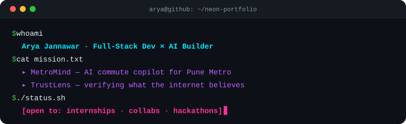

<!-- ═══════════════════════════════════════════════════════════════════
     ARYA JANNAWAR · NEON.OS v2.0
     Hand-crafted animated SVGs + live widgets.
     Before shipping: search this file for "TODO-" and fill the gaps.
     ═══════════════════════════════════════════════════════════════════ -->

  
  
  

 

  

## ⚡ SYSTEM_OVERVIEW

<table>
<tr>
<td width="60%" valign="top">
  
</td>
<td width="40%" valign="top">
  <b>🔮 LIVE_SIGNALS</b>  
  🔭 building <b><a href="https://arya-jannawar.github.io/MetroMind/">MetroMind</a></b> — AI copilot for the Pune Metro  
  🌱 deep-diving <b>AI/LLM engineering</b> &amp; full-stack systems  
  🏁 <b>Codex Dayline</b> hackathon — Urban Mobility track  
  📮 open to <b>internships · collabs · hackathons</b>  
  ⚡ motto: <i>coffee ➜ code ➜ ship</i>
</td>
</tr>
</table>

## 🕹 PIXEL_MODE

  
   
  <i>// me.exe — rendered at 32×32 · low res, high vibes</i>

## 🧠 TECH_ARSENAL

    
  

 

  
  
  

## 📊 LIVE_TELEMETRY

  
  

 

  

 

  

## 🚀 FEATURED_BUILDS

<b>🗂 ALL_DEPLOYMENTS</b> — click to expand

 

| Repo | Status | Stack |
|---|---|---|
| **[MetroMind](https://github.com/Arya-jannawar/MetroMind)** | 🟢 live demo | TypeScript · AI |
| **[trustlens](https://github.com/Arya-jannawar/trustlens)** | 🔧 in build | TypeScript |
| **[AI_powered_pharmacy_system](https://github.com/Arya-jannawar/AI_powered_pharmacy_system)** | 🔧 in build | Python |
| **[verity-graph](https://github.com/Arya-jannawar/verity-graph)** | 🔬 research | C++17 · Python |
| **[tracevault](https://github.com/Arya-jannawar/tracevault)** | 🔬 research | Python · RAG |
| **[Jallekha](https://github.com/Arya-jannawar/Jallekha)** | 🚧 incubating | — |
| **[Vishwakarandak](https://github.com/Arya-jannawar/Vishwakarandak)** | 🧪 experiment | — |
| **[dayton](https://github.com/Arya-jannawar/dayton)** *(fork)* | 📦 exploring | infra for AI-generated code |

## 🏆 TROPHY_SHELF

  

## 🐍 SNAKE.EXE

<picture>
  <source media="(prefers-color-scheme: dark)" srcset="https://raw.githubusercontent.com/Arya-jannawar/Arya-jannawar/output/github-contribution-grid-snake-dark.svg"/>
  <source media="(prefers-color-scheme: light)" srcset="https://raw.githubusercontent.com/Arya-jannawar/Arya-jannawar/output/github-contribution-grid-snake.svg"/>
  
</picture>

<i>eating my contributions one cell at a time 🐍</i>

## 📡 OPEN_CHANNEL

  <!-- TODO-LINKEDIN: replace with your real LinkedIn profile URL -->
  
  <!-- TODO-EMAIL: replace with your real email address -->
  
  

 

